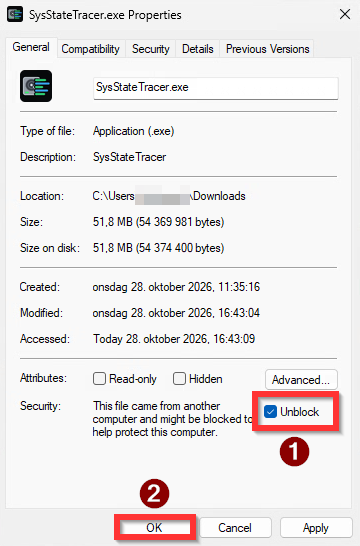
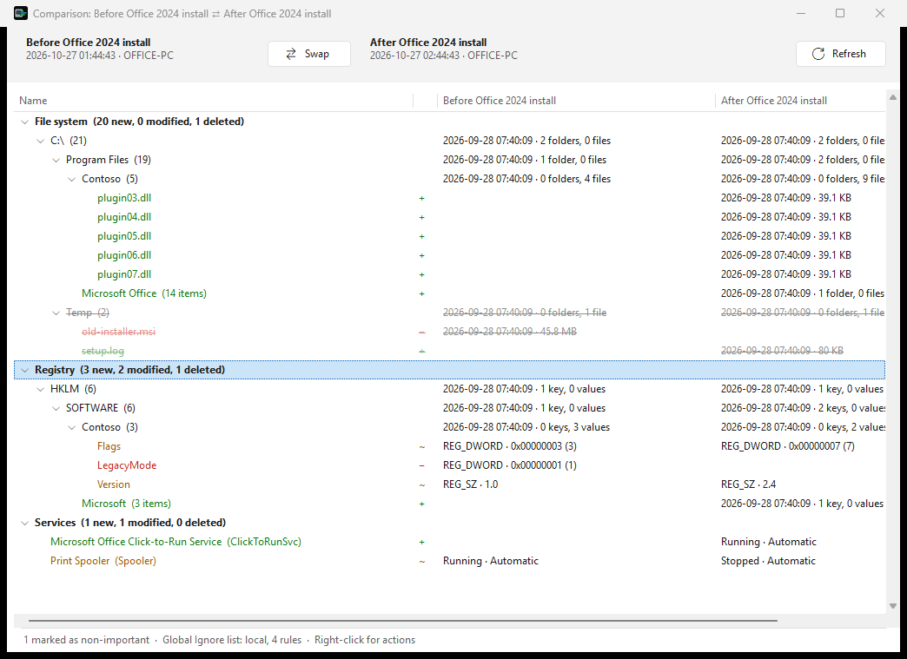
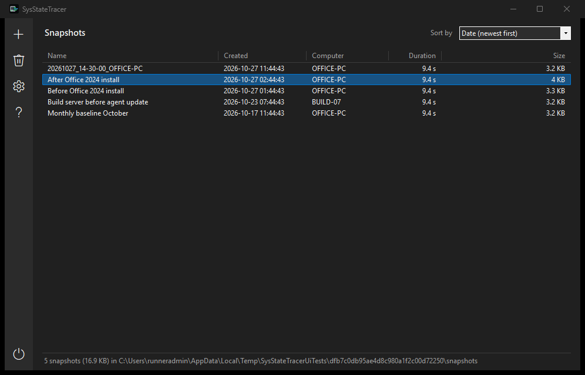

# SysStateTracer

Portable Windows utility that takes snapshots of the file system, registry and services, and compares two
snapshots to show what was created, modified or deleted in between — for example, what an installer really did.

[](https://github.com/IgorZaharov/SysStateTracer/releases/latest/download/SysStateTracer.exe)
[](https://github.com/IgorZaharov/SysStateTracer/releases/latest/download/Manual.pdf)
[](https://github.com/IgorZaharov/SysStateTracer/releases/latest)

**Before the first start:** the exe is not code-signed, so Windows blocks a downloaded copy. Right-click
`SysStateTracer.exe` → **Properties**, (1) tick **Unblock** at the bottom of the General tab, and (2) click **OK**.





## Download

Direct links to the latest version — click to download, no GitHub account needed:

- **[SysStateTracer.exe](https://github.com/IgorZaharov/SysStateTracer/releases/latest/download/SysStateTracer.exe)** — the program: one file for Windows 10 and 11 x64, nothing to install.
- **[Manual.pdf](https://github.com/IgorZaharov/SysStateTracer/releases/latest/download/Manual.pdf)** — the user manual, with screenshots.
- [SysStateTracer.exe.sha256](https://github.com/IgorZaharov/SysStateTracer/releases/latest/download/SysStateTracer.exe.sha256) — the exe's SHA-256; check it in PowerShell with
  `(Get-FileHash .\SysStateTracer.exe).Hash`.

Please, report any bugs or issues to the document here:
- **[BUGS/ISSUES](https://github.com/IgorZaharov/SysStateTracer/issues)**
  
Older versions and release candidates are on the [Releases](https://github.com/IgorZaharov/SysStateTracer/releases) page.

On first start:

- **No UAC prompt:** it starts with your own rights, and works for a standard user too. Snapshots are then
  missing the folders and registry keys only an administrator can read (they are greyed out in New Snapshot).
  For complete snapshots — and much faster reading of whole drives — click **Restart as administrator**.
- **SmartScreen:** if you did not tick **Unblock** (above), Windows may say "Windows protected your PC". Choose
  **More info → Run anyway**.

SysStateTracer keeps its files beside the exe (settings, the ignore list, a cache for faster snapshots, a log,
and the `Files` and `Backups` folders). If that folder cannot be written to, it uses
`%LOCALAPPDATA%\SysStateTracer` instead.

## How to use it

1. Click **+** and **Start** to take a snapshot (the default scope is every fixed drive, the registry and services).
2. Make the change you want to trace: install a program, change a setting, run an update.
3. Take a second snapshot — it is faster, because only what changed is read again.
4. Drag one snapshot onto the other. The comparison shows only what changed: new in green, modified in yellow,
   deleted in red.
5. Right-click items to open them in Explorer, Regedit or Services, export registry changes to a `.reg` file,
   copy new and modified files to `.\Files`, revert registry values, or hide noise with the Global Ignore list.



Everything also works from the command line, for scripts and scheduled tasks:

```bat
SysStateTracer.exe /new-snap "Before Office 2024 install"
SysStateTracer.exe /new-snap "After Office 2024 install"
SysStateTracer.exe /compare-snap "Before Office 2024 install" "After Office 2024 install" "C:\Reports\Office 2024 install changes.html"
SysStateTracer.exe /export "Before Office 2024 install" "After Office 2024 install"
```

`SysStateTracer.exe /?` lists every switch with examples; see [docs/command-line.md](docs/command-line.md).

## What it records — and what it does not

- **Files and folders:** names, sizes, dates and attributes. File contents are never read, so a file rewritten
  with the same size and date is not seen as changed.
- **Registry:** HKLM and every user under HKU, with values up to 1 MB (larger values are recorded by size and hash).
  `HKLM\SAM` and `HKLM\SECURITY` are left out by default.
- **Services:** state and startup type; kernel drivers optionally.
- Anything that cannot be read is skipped and listed in the snapshot's properties.

**Snapshots contain registry data, which can include sensitive settings such as product keys.** Treat `.stsnap`
files like a registry backup and don't share them publicly.

## Documentation

The user manual, **Manual.pdf**, comes with every [release](https://github.com/IgorZaharov/SysStateTracer/releases);
the latest build of it is on the [`ui-preview`](https://github.com/IgorZaharov/SysStateTracer/releases/tag/ui-preview) pre-release.

| Document | Contents |
| --- | --- |
| [docs/user-interface.md](docs/user-interface.md) | The windows, keyboard shortcuts, and the manual test script |
| [docs/command-line.md](docs/command-line.md) | Switches, examples, exit codes |
| [docs/ignore-list.md](docs/ignore-list.md) | Global Ignore list: local and remote lists, rule syntax |
| [docs/exports.md](docs/exports.md) | `.reg` export, copy to `.\Files`, Revert Value |
| [docs/benchmarks.md](docs/benchmarks.md) | Measured speed and memory |
| [docs/format.md](docs/format.md) | The `.stsnap` file format |
| [docs/decisions.md](docs/decisions.md) | Design decisions |
| [CHANGELOG.md](CHANGELOG.md) | What changed in each release |

## Building

Requirements: Windows 10/11 x64, [.NET 10 SDK](https://dotnet.microsoft.com/download/dotnet/10.0). Visual Studio 2026 is optional.

```powershell
dotnet build                                     # build everything
dotnet test                                      # run tests
dotnet publish src/SysStateTracer -c Release     # single-file SysStateTracer.exe
```

Every push to `main` is built and tested on GitHub Actions (including window screenshots in both themes on the
[`ui-preview`](https://github.com/IgorZaharov/SysStateTracer/releases/tag/ui-preview) pre-release, and an
end-to-end run on clean Windows Server 2022 and 2025 runners). A tag such as `v1.0.0` publishes a release.

| Path | Contents |
| --- | --- |
| `src/SysStateTracer` | Windows Forms UI, command line, entry point |
| `src/SysStateTracer.Core` | Scanning, snapshot storage, comparison, exports (no UI code) |
| `tests/` | Unit tests, Windows integration tests, window tests with screenshots, benchmarks |
| `docs/` | Documentation |
